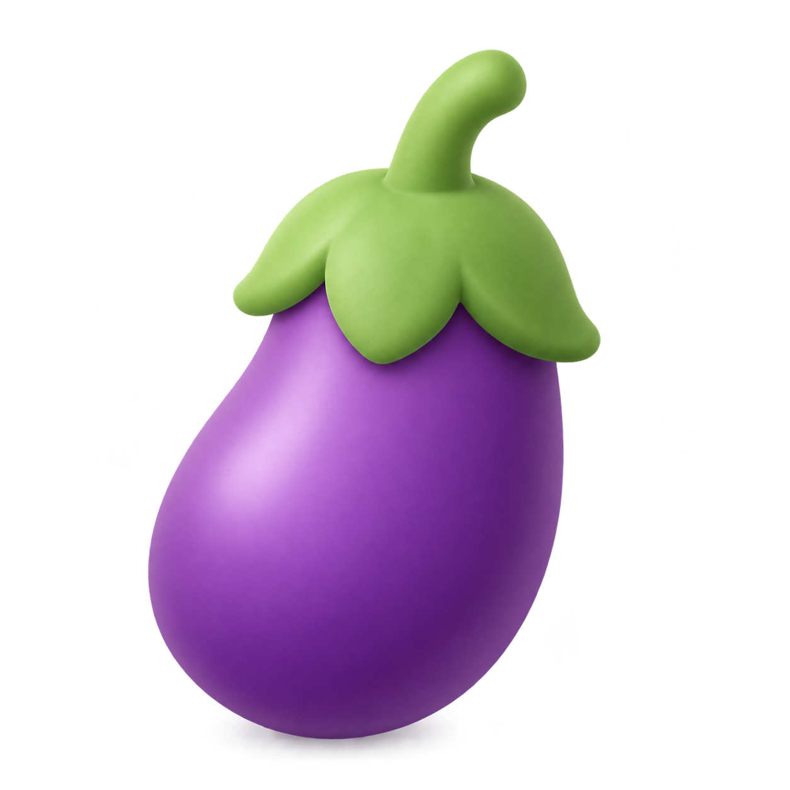
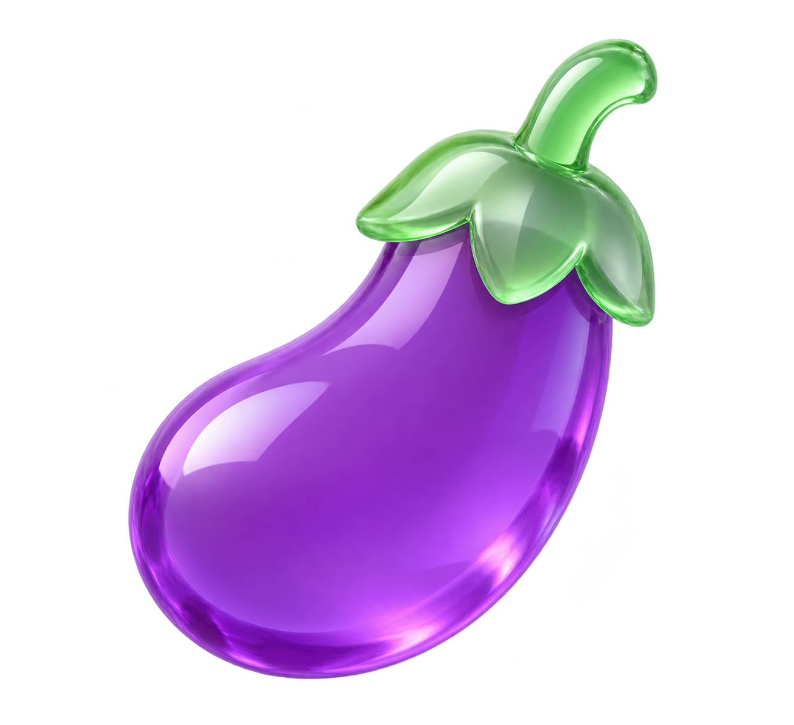

<div align="center">

# Icon Material Studio

### Find the right shape. Give it a little depth.

**Soft clay · Transparent glass · Transparent PNG · Traceable sources**

[简体中文](README.md) · **English**

[Get started](#get-started) · [Workflow](#workflow) · [Sources and commercial use](#sources-and-commercial-use) · [Skill instructions](SKILL.md)

</div>

---

## Two materials, one friendly icon family

<table>
<tr><th width="50%">Soft Clay</th><th width="50%">Transparent Glass</th></tr>
<tr><td align="center"></td><td align="center"></td></tr>
<tr><td align="center">Rounded volume · Diffuse highlights · Soft texture</td><td align="center">Translucent edges · Refraction · Clear highlights</td></tr>
</table>

These are actual generated transparent PNG examples. “3D” describes the visual treatment; delivered images are raster illustrations. Both examples were generated from text without uploading third-party images as generation inputs. See [example provenance](assets/CREDITS.md).

## Get started

Download the repository and extract it into your Codex skills directory:

```text
~/.codex/skills/icon-material-studio/
├── SKILL.md
├── agents/
├── references/
└── assets/
```

Or ask Codex to install it:

```text
Install this skill: https://github.com/iTuer/icon-material-studio
```

Then describe your icon:

> Use $icon-material-studio to make a purple and green eggplant icon in transparent glass, with a transparent background, for a 48px interface.

> Find three commercially usable shapes for a “completed” icon, then turn the selected one into red soft clay.

> Make a consistent set of book, notes, and paper icons in cream and purple soft clay. Deliver a PNG package.

Short replies such as “02,” “make it glass,” or “try both” continue the current selection.

## Workflow

**Brief → Source and license checks → Shape selection → Clay or glass generation → Small-size review → File delivery**

| Step | What you receive |
|---|---|
| Define the brief | Subject, material, palette, size, and commercial requirements; existing choices are retained |
| Find candidates | A small, varied shortlist with original resource links and license status |
| Create the material | Consistent depth, viewing angle, lighting, roundness, and colors |
| Review the result | Recognition at the intended size, contrast on light and dark surfaces, and real alpha transparency |
| Deliver files | Direct PNG downloads; sets can be packaged as ZIP with source and license records |

This skill focuses on **soft clay and transparent glass**. Explicit requests for flat, vector, or other material styles use ordinary image or vector tools. Generation requires an image tool supplied by the host environment; this repository contains no model or API key.

## Where it searches

| Channel | Purpose |
|---|---|
| Installed icon skills and local packages | Reuse available families such as Naive Icons or Lucide |
| Project assets and design systems | Match the existing product |
| Creator websites and GitHub repositories | Locate original files, versions, and licenses |
| [Iconify](https://icon-sets.iconify.design/) | Discover icon families and trace them to their creators |
| [OpenMoji](https://openmoji.org/) and [Wikimedia Commons](https://commons.wikimedia.org/) | Explore subjects and shapes, checking each asset's license |
| Noun Project, Flaticon, Envato, and UI8 | Search specialized styles within an authorized budget |
| General image search | Discover visual directions and find their original sources |

These are available channels. Each delivery identifies the channels **actually searched**, rather than implying that every listed site was used.

## Sources and commercial use

Every handoff includes:

- **Search channels:** the sources actually consulted.
- **Original resource links:** the specific icon and license page, or an explicit text-only origin.
- **Download links:** actual image files or a ZIP package.
- **Commercial status:** permitted use and conditions, purchase requirements, noncommercial restrictions, or unresolved rights.
- **Derivation:** whether a source informed the shape, provided a material reference, or was not used as an image input.

Free download does not automatically mean commercial use is permitted. Source licenses and AI generation service terms are recorded separately. Recoloring or changing material does not automatically remove source obligations. AI-generated output is not automatically open source or exclusive.

The skill text currently has no separate open-source license. See [CREDITS](assets/CREDITS.md) for example-image provenance; third-party resources retain their own licenses.

## Validation

The clay and transparent-glass image workflows have been run, with alpha transparency and 32px/48px light and dark previews checked. Skill structure validation passed. See the [test report](TEST-REPORT.md).
