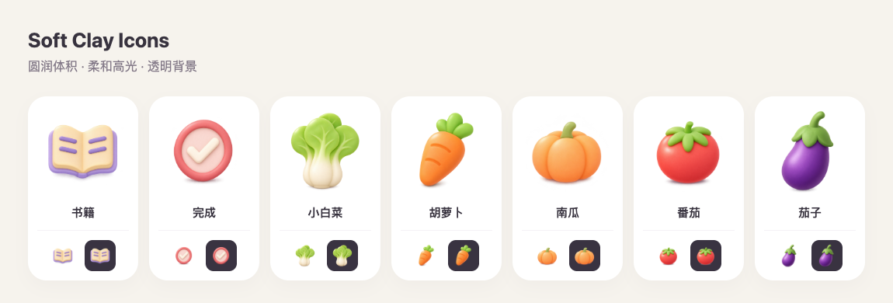
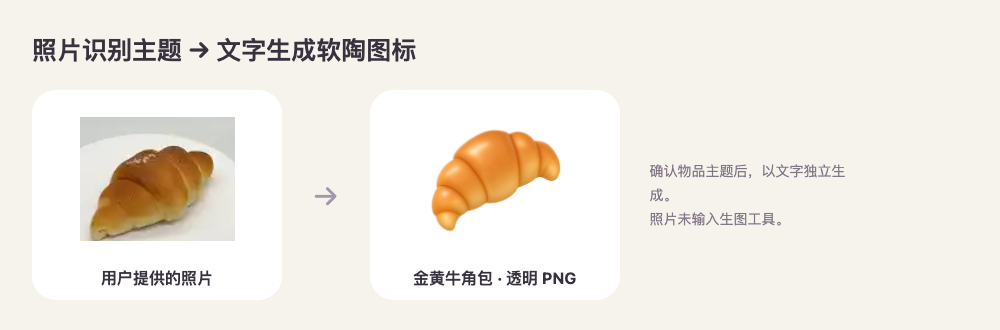

# Icon Material Studio

**简体中文** · [English](README.en.md)

说一个物品，或给一张图片。生成软陶图标。

## 案例：牛角包

[下载透明 PNG](assets/croissant-clay.png)。看图确认主题后，以文字独立生成，原照片未输入生图工具。AI 图片的商业使用遵循适用服务条款，详见[来源说明](assets/CREDITS.md)。

## 怎么用

安装：`https://github.com/iTuer/icon-material-studio`

然后只说 **“茄子”**、**“书本”**，或上传参考图片。默认软陶材质、透明 PNG；配色和商用条件按需补充，不需要写长提示词。

简单物品默认直接生成，不强制检索外部图标。使用内置标定板时，会明确记录为 AI 材质参考；它可帮助保持一致，但不保证完全一致。

## 工作流程

寻找造型 → 核对授权 → 生成软陶 → 检查小尺寸 → 交付 PNG／ZIP。

需要检索造型时，优先检索免费可商用资源；没有合适结果时，再提供付费商用候选，附原素材和许可链接，购买前确认。

## 来源与交付

检索渠道包括已安装图标库、项目素材、原作者网站与 GitHub、Iconify、OpenMoji、Wikimedia Commons 和商用素材平台。每次交付附实际搜索渠道、原素材链接、许可条件、商用状态及文件下载链接。

## 示例参考

| 示例 | 造型参考 | 材质参考 |
|---|---|---|
| 书籍 | [Solar notebook-2](https://icon-sets.iconify.design/solar/notebook-2-bold-duotone/) | - |
| 完成、小白菜、胡萝卜、南瓜、番茄 | - | 已生成的书籍图 |
| 茄子 | - | - |

示例为 AI 生成 PNG，部分历史参考的商用授权尚未确认。[详细来源与授权](assets/CREDITS.md)。

[SKILL.md](SKILL.md) · [Test report](TEST-REPORT.md)

## 只读检查

`python3 scripts/inspect_icon.py icon.png --out-dir preview`

区分完全不透明与接近不透明像素，校验支持格式的 PNG 数据，生成 1:1 与小尺寸浅深底预览。不支持的编码会明确报告，不能当作通过；视觉效果仍需实际查看。
