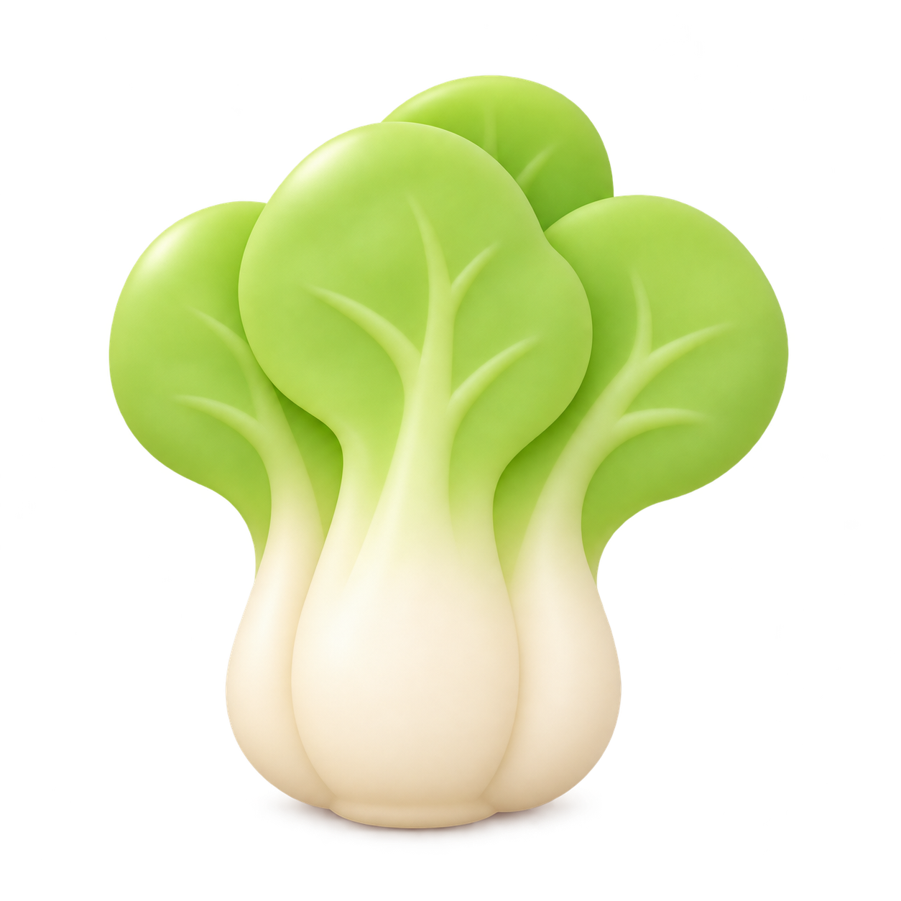
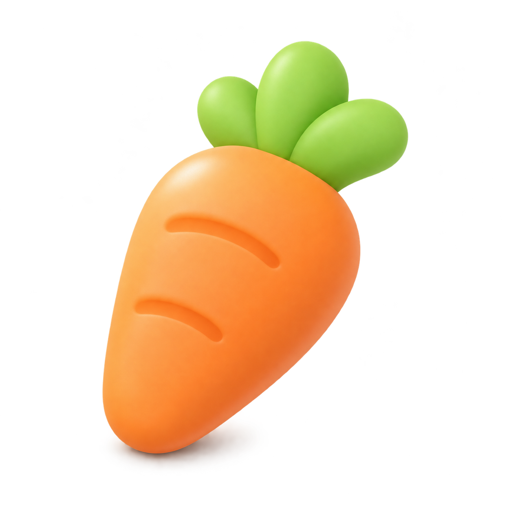
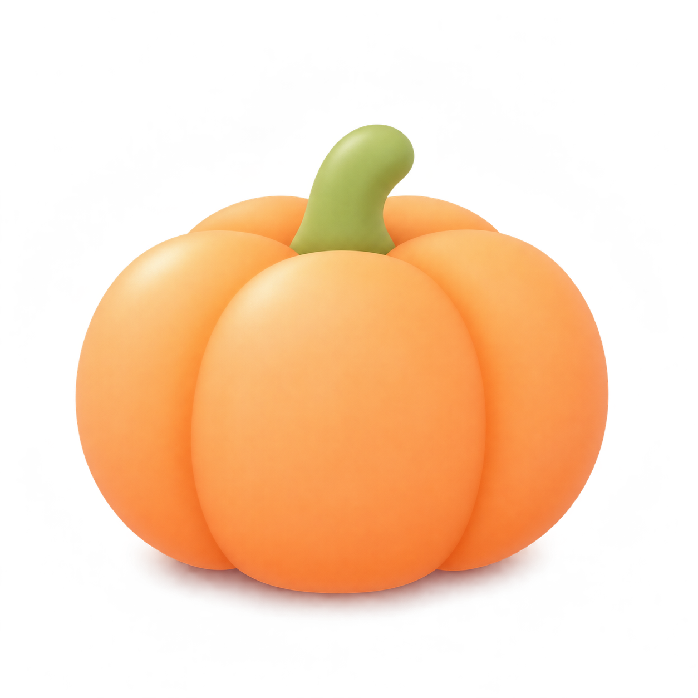
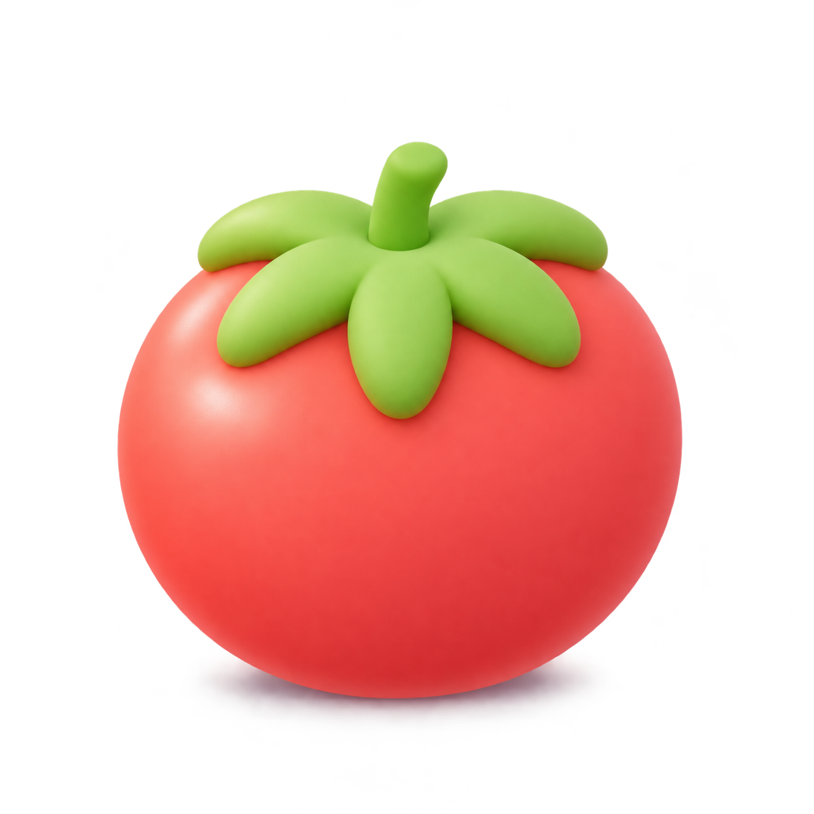

<div align="center">

# Icon Material Studio

### 圆润软陶，有体积的可爱

<p align="center"></p>

以上是实际生成的透明 PNG 示例。3D 指图标的视觉效果，交付文件是位图插画。示例由文字提示生成，没有将第三方图片上传为生成输入；详细来源见 [示例说明](assets/CREDITS.md)。

## 不只有茄子：一组软陶示例

| 造型来源 | 材质参考（不是物品原图） | 生成结果 |
|---|---|---|
| <br>[Solar notebook-2](https://icon-sets.iconify.design/solar/notebook-2-bold-duotone/) | [Fitness screenshot](https://github.com/mitesh77/Best-Flutter-UI-Templates/blob/master/best_flutter_ui_templates/assets/fitness_app/fitness_app.png) |  |
| 文字描述：红圈对勾。没有使用对应物品原图。 | <br>书籍图：仅参考软陶材质 |  |
| 文字描述：小白菜。没有使用对应物品原图。 | <br>书籍图：仅参考软陶材质 |  |
| 文字描述：胡萝卜。没有使用对应物品原图。 | <br>书籍图：仅参考软陶材质 |  |
| 文字描述：南瓜。没有使用对应物品原图。 | <br>书籍图：仅参考软陶材质 |  |
| 文字描述：番茄。没有使用对应物品原图。 | <br>书籍图：仅参考软陶材质 |  |
| 文字描述：茄子。没有使用对应物品原图。 | 文字指定软陶材质，无图片输入 |  |

[Book style reference / 书籍材质参考：Fitness screenshot](https://github.com/mitesh77/Best-Flutter-UI-Templates/blob/master/best_flutter_ui_templates/assets/fitness_app/fitness_app.png) · [Source and license details / 来源与授权](assets/CREDITS.md)


以上为 AI 生成材质示例。书籍有额外的源素材授权条件，其余示例沿用了它的材质参考。详见[来源与限制](assets/CREDITS.md)，整组展示不代表已获无条件商用授权。

## 从输入到结果

可以直接上传一张或多张参考图片，也可以只描述物品。优先检索**免费可商用资源**；没有合适结果时，再提供标明价格与授权条件的付费商用候选，附原素材链接，购买前征得同意。

| 输入／研究参考 | → 软陶效果 |
|---|---|
| 文字描述：紫色茄子、绿色叶冠、圆润可爱、透明背景 |  |
| <br>[原图造型研究：Naive Icons 茄子](https://github.com/guokaigdg/naive-icons/blob/main/svg/eggplant.svg) · [MIT 许可](https://github.com/guokaigdg/naive-icons/blob/main/LICENSE) |  |

第二行展示研究来源与材质结果的对照：原 SVG 未作为生成图片输入，不能视为精确的“原图转换”。上传图片后可按其造型做材质改写，并记录真实输入关系。

## 开始使用

把本仓库下载并解压到 Codex 的 skills 目录，文件结构如下：

```text
~/.codex/skills/icon-material-studio/
├── SKILL.md
├── agents/
├── references/
└── assets/
```

也可以在 Codex 中发送仓库地址并要求安装：

```text
安装这个 skill：https://github.com/iTuer/icon-material-studio
```

安装后，只说物品名就能开始：

> 茄子

> 书本

> 一个红旗

默认采用软陶材质、透明 PNG 和适合物品的自然配色。光照、角度、构图与小尺寸辨认度由助手处理，不需要用户写长提示词。想微调时，再补一句“紫色一点”“更圆润”或“需要商用”即可。

## 工作流程

**需求 → 搜索与授权筛选 → 选择造型 → 软陶生成 → 小尺寸检查 → 下载交付**

| 步骤 | 你会拿到什么 |
|---|---|
| 明确需求 | 主题、材质、配色、尺寸和商用条件；已有信息直接沿用 |
| 搜索候选 | 少量有区分度的造型，附资源地址和授权状态 |
| 制作材质 | 统一视角、光照、圆润程度和色板的 3D 视觉图标 |
| 检查效果 | 目标尺寸的辨认度、浅深背景对比和真实透明通道 |
| 图片交付 | PNG 下载链接；多图可打包 ZIP，附来源和授权记录 |

该 skill 专注 **软陶**。明确需要扁平、矢量或其他材质时，使用普通出图能力。生成依赖宿主提供的图片生成工具，本仓库不包含模型或 API 密钥。

## 从哪里找图标

| 渠道 | 用途 |
|---|---|
| 已安装的图标 skills 与本地图标包 | 优先复用现有风格，例如 Naive Icons、Lucide |
| 项目素材与设计系统 | 保持当前产品的一致性 |
| 原作者网站与 GitHub | 寻找原始文件、版本与授权 |
| [Iconify](https://icon-sets.iconify.design/) | 发现不同图标家族，再追溯原作者 |
| [OpenMoji](https://openmoji.org/)／[Wikimedia Commons](https://commons.wikimedia.org/) | 扩展主题与造型选择，逐项检查许可 |
| Noun Project、Flaticon、Envato、UI8 | 按预算检索特定风格，购买前取得授权 |
| 通用图片搜索 | 寻找视觉方向，并追溯原始资源页 |

渠道列表表示可用范围。每次交付会写明**实际搜索了哪些渠道**，不会把未检索的网站写成已使用来源。

## 素材与商用

每次交付都需要附上：

- **搜索渠道**：本次真正使用的来源。
- **原资源链接**：具体图标与许可页；纯文字原创生成则明确注明。
- **下载链接**：可直接取得的图片文件或 ZIP。
- **商用状态**：可免费商用的条件、需购买、仅非商用，或授权尚未确认。
- **修改关系**：借用了造型、材质参考，还是没有第三方图片输入。

免费可下载不代表可以商用。源图的许可与 AI 输出的服务条款分别记录；修改颜色或材质不会自动消除原素材的授权义务。AI 生成结果也不自动成为开源素材或具有独占性。

本仓库目前没有为 skill 文本指定单独的开源许可。图标示例的使用说明见 [CREDITS](assets/CREDITS.md)，第三方资源以各自许可为准。

## 验证记录

软陶图片流程已实际运行，检查了透明通道及 32px／48px 的浅深背景效果。Skill 结构通过校验。详见 [测试记录](TEST-REPORT.md)。
